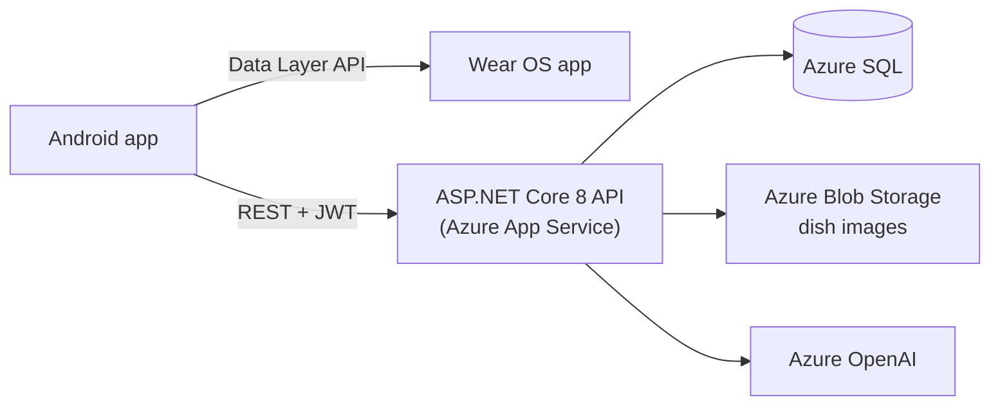

# Smart Menza


[](LICENSE)

Canteen app for students and staff, with an ASP.NET Core REST API on Azure and Android and Wear OS apps in Kotlin.
It was a team project at the Faculty of Organization and Informatics (FOI), run with Span.

This repository is a copy of the team repository from Azure DevOps, and the Azure backend is no longer online.



## Highlights

- A team of 5 built the system in Scrum sprints, with user stories and retrospectives.
- The backend has 4 .NET projects and a test project with 20 xUnit tests.
- 2 AI checks use Azure OpenAI to find allergens and to estimate the nutrition values of a dish.
- The Wear OS app shows today's lunch and dinner without a single call to the API.

## My part

I was 1 of 4 backend developers in a team of 5, and I built the Wear OS module alone.

| Area | What I built |
|---|---|
| Database | First tables as EF Core migrations, applied when the API starts |
| Daily menus | Endpoints for today's menu, a menu by date, and create, update and delete |
| Dishes | Create, update and delete, image upload to Azure Blob Storage |
| Reviews | Repository, service and endpoints, reviews in the dish details |
| Registration | User registration with validation and a JWT token |
| Swagger | Swagger UI with a JWT token field for the protected endpoints |
| Wear OS | The whole `wear` module and the sync on the phone side |

## Features

Students and canteen staff see different screens after login.
The AI checks send the ingredient list of a dish to Azure OpenAI.

| Area | Features |
|---|---|
| Menu | Daily menu for lunch and dinner, dish details with nutrition values and reviews |
| Students | Favourite dishes, nutrition goals, a daily food log measured against the goals |
| Staff | Menus and dishes (create, edit, delete), dish images, the most favourited dishes |
| AI checks | Allergens and diet labels (vegan, vegetarian, gluten-free), calories and nutrients for 1 serving |
| Login | Email and password or a Google account, a JWT token for most endpoints |

## Backend

`SmartMenza.sln` holds the ASP.NET Core 8 API, split into layers.

| Project | Folder | Contents |
|---|---|---|
| SmartMenza.API | [`SmartMenza/`](SmartMenza/) | Controllers, Swagger and startup |
| SmartMenza.Business | [`SmartMenza.Business/`](SmartMenza.Business/) | Services, JWT, Blob Storage and Azure OpenAI clients |
| SmartMenza.Data | [`SmartMenza.Data/`](SmartMenza.Data/) | EF Core context, entities, migrations and repositories |
| SmartMenza.Core | [`SmartMenza.Core/`](SmartMenza.Core/) | Shared enums and settings |
| SmartMenza.UnitTests | [`SmartMenza.UnitTests/`](SmartMenza.UnitTests/) | 20 xUnit tests |

## Android app

The Android app is split into 7 Gradle modules.

| Module | Contents |
|---|---|
| [`app`](app/) | Screens (fragments with XML layouts), session, and the sync to the watch |
| [`core`](core/) | Retrofit clients and data models used by the other modules |
| [`mailauth`](mailauth/) | Login and registration with email and password |
| [`googleauth`](googleauth/) | Login with a Google account |
| [`navigation`](navigation/) | Bottom navigation, with different items for students and staff |
| [`topbar`](topbar/) | Top bar with logout and sync with the watch |
| [`wear`](wear/) | The Wear OS app, in Compose for Wear OS |

## Wear OS sync

The watch shows today's lunch and dinner, and the phone sends them over the Wearable Data Layer API.
The sync starts when a student taps "Sinkronizacija sa satom" (sync with watch) in the phone app.

| Step | Where | What happens |
|---|---|---|
| 1 | Phone, `MenuSyncManager` | Writes today's lunch and dinner to the data path `/menu_items`, or an empty menu if there is none |
| 2 | Watch, `WearDataListenerService` | Receives the data and saves it with `MenuStorage`, so it stays after a restart |
| 3 | Watch, `MenuViewModel` | Reads the saved menu every 2 seconds, so a new sync appears without reopening the app |

## Tech stack

| Layer | Tools |
|---|---|
| Database | Azure SQL, Entity Framework Core |
| Backend | ASP.NET Core 8, JWT, Swagger |
| Cloud | Azure App Service, Azure Blob Storage, Azure OpenAI |
| Tests | xUnit, Moq |
| Android | Kotlin, Retrofit, Google Sign-In |
| Wear OS | Kotlin, Compose for Wear OS, Wearable Data Layer API |

## Run locally

The development settings use SQL Server LocalDB and the Azurite storage emulator.
Requires the .NET 8 SDK, SQL Server LocalDB, Azurite and Android Studio.

1. Start Azurite, which stores the dish images on `127.0.0.1:10000`.
2. Add your own Azure OpenAI endpoint and key to `SmartMenza/appsettings.json`, for the AI checks.
3. Start the API, which applies the migrations and shows Swagger on `http://localhost:5166/swagger`:
   ```bash
   dotnet run --project SmartMenza --launch-profile http
   ```
4. Run the unit tests:
   ```bash
   dotnet test
   ```
5. In `core/src/main/java/foi/cverglici/core/data/api/ApiConfig.kt`, set `BASE_URL` to the commented address `http://10.0.2.2:5166/`.
6. In Android Studio, run `app` on an emulator with Android 11 (API 30) or newer.
7. Run `wear` on a Wear OS emulator paired with the phone, then tap sync in the phone app to see today's menu on the watch.

## Project structure

| Folder | Contents |
|---|---|
| [`docs/`](docs/) | Team wiki from Azure DevOps, in Croatian: architecture, epics and user stories, sprint plan |
| [`docs/attachments/`](docs/attachments/) | Diagrams, Figma prototype screens and setup screenshots |

## License

GPL-3.0, see [LICENSE](LICENSE).
