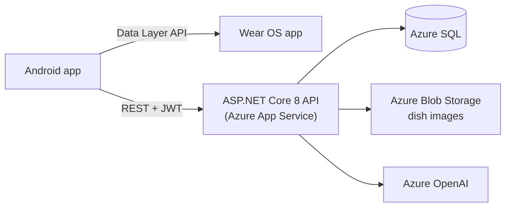

# Smart Menza

A canteen app for students and canteen staff. Students see the daily menu, the nutrition
values and reviews of each dish, and their own nutrition goals. Staff manage menus and dishes
and can check a dish's ingredients with Azure OpenAI.

It was a team project of five students at the Faculty of Organization and Informatics (FOI),
for the course Software Analysis and Design. The project was also part of Agile Mobile Application
Development, a Joint Creative Classroom (JCC) run with Span. It added two hours of lectures a
week and 2 ECTS on top of the course. We worked in Scrum sprints, with user stories and retrospectives. The backend is an
ASP.NET Core 8 REST API on Azure. The Android and Wear OS apps are in Kotlin.

This repository is a copy of the team repository from Azure DevOps. The Azure backend is no
longer online, so the app needs a local backend to show data.

## My part

I worked on the backend with three other developers, and I built the Wear OS module on my own.

| Area | What I built |
|---|---|
| Database | The first tables as EF Core migrations, and applying the migrations when the API starts |
| Daily menus | Endpoints for today's menu and for a menu by date, then create, update and delete |
| Dishes | Create, update and delete for dishes, and image upload to Azure Blob Storage |
| Reviews | Repository, service and endpoints for dish reviews, and the reviews in the dish details |
| Registration | User registration with validation, which returns a JWT token |
| Swagger | Swagger UI for the API, with a JWT token field for testing the protected endpoints |
| Wear OS | The whole `wear` module and the sync on the phone side |

## Wear OS module

The watch shows today's lunch and dinner and never calls the API. The phone sends it the menu
over the Wearable Data Layer API. A student opens the menu in the phone app and taps
"Sinkronizacija sa satom" (sync with watch) in the top bar.

| Step | Where | What happens |
|---|---|---|
| 1 | phone, `MenuSyncManager` | Writes today's lunch and dinner to the data path `/menu_items` |
| 2 | watch, `WearDataListenerService` | Receives the data and saves it with `MenuStorage` (SharedPreferences) |
| 3 | watch, `MenuViewModel` | Reads the saved menu every two seconds, so a new sync appears without reopening the app |

The saved menu stays on the watch after a restart. If there is no menu for the day, the sync
clears the old one.

## What the app does

| Role | Features |
|---|---|
| Student | Daily menu for lunch and dinner, dish details with nutrition values and reviews, favourite dishes, nutrition goals, and a daily food log measured against those goals |
| Canteen staff | Menus and dishes (create, edit, delete), dish images, AI checks of the ingredients, and the most favourited dishes |

Users log in with email and password or with a Google account. The API returns a JWT token,
and most endpoints require it.

The AI checks send the ingredient list to Azure OpenAI. One returns the allergens and whether
the dish is vegan, vegetarian or gluten-free. The other estimates calories, protein,
carbohydrates, fat, fibre and salt for one serving.

## Architecture

Backend, `SmartMenza.sln`:

| Project | Folder | Contents |
|---|---|---|
| SmartMenza.API | `SmartMenza/` | Controllers, Swagger and startup |
| SmartMenza.Business | `SmartMenza.Business/` | Services, request and response models, JWT, Blob Storage and Azure OpenAI clients |
| SmartMenza.Data | `SmartMenza.Data/` | EF Core context, entities, migrations and repositories |
| SmartMenza.Core | `SmartMenza.Core/` | Shared enums and settings |
| SmartMenza.UnitTests | `SmartMenza.UnitTests/` | 20 xUnit tests |

Android, Gradle modules:

| Module | Contents |
|---|---|
| `app` | Screens (fragments with XML layouts), session, and the sync to the watch |
| `core` | Retrofit clients and data models used by the other modules |
| `mailauth` | Login and registration with email and password |
| `googleauth` | Login with a Google account |
| `navigation` | Bottom navigation, with different items for students and staff |
| `topbar` | Top bar with logout and sync with the watch |
| `wear` | The Wear OS app, in Compose for Wear OS |

## Run locally

Backend, with the .NET 8 SDK:

1. Fill in `SmartMenza/appsettings.json`: a SQL Server connection string, a JWT secret key,
   and the Azure Blob Storage and Azure OpenAI settings.
2. Run `dotnet run --project SmartMenza --launch-profile http`. The API applies the
   migrations, starts on `http://localhost:5166` and shows Swagger at `/swagger`.
3. Run `dotnet test` for the unit tests.

Android, in Android Studio:

1. In `core/src/main/java/foi/cverglici/core/data/api/ApiConfig.kt`, switch `BASE_URL` to the
   commented address `http://10.0.2.2:5166/`. That is the host machine as seen from the
   emulator.
2. Run `app` on an emulator with Android 11 (API 30) or newer.
3. For the watch, run `wear` on a Wear OS emulator paired with the phone emulator.

## Documentation

`docs/` holds the team's Azure DevOps wiki, in Croatian.

| File | Contents |
|---|---|
| [`Arhitektura-proizvoda-i-podsustava.md`](docs/Arhitektura-proizvoda-i-podsustava.md) | Architecture of the system and its parts |
| [`Funkcionalnosti-aplikacije-(epics,-korisničke-priče).md`](docs/Funkcionalnosti-aplikacije-(epics,-korisni%C4%8Dke-pri%C4%8De).md) | Epics and user stories |
| [`Plan-iteracija.md`](docs/Plan-iteracija.md) | Sprint plan |
| [`attachments/`](docs/attachments/) | Diagrams, Figma prototype screens and setup screenshots |

## License

GPL-3.0, see [LICENSE](LICENSE).
